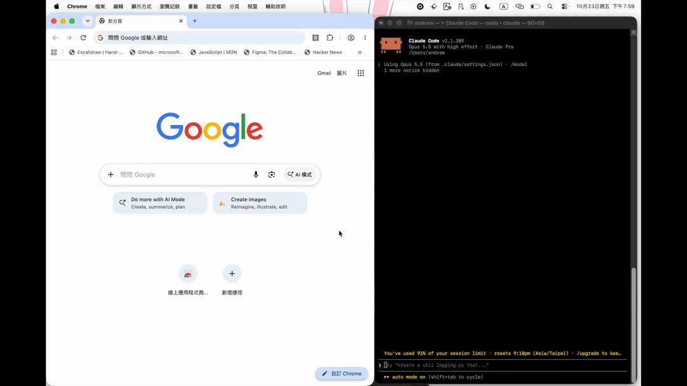

# Bookmark Organizer

Let a coding agent such as Claude Code tidy your Chrome bookmarks: give every bookmark a short, clear name, sort them
into folders, and remove duplicates. You see every change before it happens, and every change can be undone.



## How it works

The agent judges, the program executes. The agent decides what each site is and where it belongs, following the
organizer skill. A Chrome extension and a local MCP server carry the decision out exactly, through Chrome's own
`chrome.bookmarks` API.

```text
Agent ──MCP──▶ MCP server ──WebSocket on 127.0.0.1──▶ Chrome extension ──▶ your bookmarks
```

- **You approve every change.** The agent writes the whole change as one plan and shows you a dry run first.
- **Nothing changes without a backup.** Applying a plan backs up the whole bookmark tree first, and the agent can
  restore any backup.
- **Bookmarks stay on your computer.** The server listens only on `127.0.0.1` and accepts only this extension.

## Install

You need Node.js 24, Chrome 134 or later, and a coding agent that speaks MCP. It has been tested with
[Claude Code](https://claude.com/claude-code) only so far. The server accepts only an extension of its own version, so
install the extension and the server (or the plugin) at the same version.

### 1. The Chrome extension, for every agent

From the [latest Release](https://github.com/cjumeow/bookmark-organizer/releases/latest), download
`bookmark-organizer-extension-0.1.1.zip` and unzip it into a folder you keep, for example `~/bookmark-organizer/`. Open
`chrome://extensions`, turn on Developer mode, choose **Load unpacked** and select the unzipped folder. Its ID is
`ancijliidboahicggjggbhlflehlnbjg`.

### 2a. The server and the skill in Claude Code: the plugin

The plugin installs the MCP server and the organizer skill together, at one version. This repository is its
marketplace. In a Claude Code session:

```text
/plugin marketplace add cjumeow/bookmark-organizer
/plugin install bookmark-organizer@cjumeow
```

Then start a new session. To upgrade, run `claude plugin marketplace update cjumeow` and
`claude plugin update bookmark-organizer@cjumeow` in your shell, and load the extension of the same version.

### 2b. The server and the skill in another agent

1. Register the MCP server. It is a stdio server from npm: the agent starts it with
   `npx -y bookmark-organizer-mcp@0.1.1` and talks to it over stdin and stdout. Cursor (`~/.cursor/mcp.json`), Codex
   (`~/.codex/config.toml`) and others take that command (`npx`) and its arguments in their MCP configuration. In
   Claude Code without the plugin, it is:

   ```bash
   claude mcp add bookmark-organizer -s user -- npx -y bookmark-organizer-mcp@0.1.1
   ```

2. Give the agent the organizer skill, which holds the rules for naming and filing: download
   `bookmark-organizer-skill-0.1.1.zip` from the same Release and put its `bookmark-organizer` folder where your agent
   reads skills (`~/.claude/skills/` for Claude Code). An agent without the skill can still use the tools, but does not
   know the naming rules.
3. Start a new session of your agent. To upgrade, repeat these steps with the new version.

## Use it

Ask in plain words, for example:

```text
Organize my bookmarks. Show me the plan first.
```

```text
Rename the bookmarks in my "Read later" folder so each one says what the site is.
```

```text
Put my bookmarks back the way they were.
```

The first request after the server starts can take up to 30 seconds while the extension connects.

## Limits

- Turn the extension on in one Chrome profile only. With several, the agent works on whichever connected first.
- It never moves a bookmark between "only on this device" and "saved in your Google Account", since that would upload
  it to Google or take it off your other devices. It tidies each group on its own.
- No changes to URLs, and no popup or other interface in the extension yet.

## Develop

To build it yourself: `npm ci && npm run build`, then load `extension/dist` and point your agent at
`node mcp-server/dist/index.js`. Start with [`AGENTS.md`][agents]. What the tools, the plan and the bridge do is in
[`docs/spec.md`][spec], the terms in [`GLOSSARY.md`][glossary], and the decisions in [`docs/adr/`][adr].

## License

[MIT][license]

<!-- Absolute links, so they also work on the npm page, which shows this README. -->

[agents]: https://github.com/cjumeow/bookmark-organizer/blob/main/AGENTS.md
[spec]: https://github.com/cjumeow/bookmark-organizer/blob/main/docs/spec.md
[glossary]: https://github.com/cjumeow/bookmark-organizer/blob/main/GLOSSARY.md
[adr]: https://github.com/cjumeow/bookmark-organizer/tree/main/docs/adr
[license]: https://github.com/cjumeow/bookmark-organizer/blob/main/LICENSE
